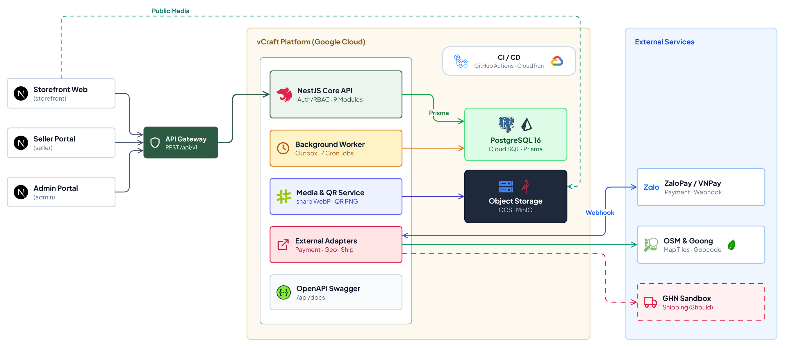

# vCraft — Triển lãm số Làng nghề Mây tre đan Phú Vinh

> Bài tập lớn môn **INT3306 — Phát triển ứng dụng web**, Fall 2026.

vCraft là nền tảng web triển lãm số và thương mại thủ công cho làng nghề mây tre đan Phú Vinh (Chương Mỹ, Hà Nội). Hệ thống hỗ trợ các hộ sản xuất giới thiệu xưởng, bán sản phẩm có sẵn, báo giá đặt làm riêng và truy xuất nguồn gốc từng lô hàng qua mã QR.

---

## Tính năng chính

- **Triển lãm số & Gian hàng xưởng:** Khám phá các hộ sản xuất mây tre đan Phú Vinh, tìm kiếm sản phẩm tiếng Việt không dấu, xem câu chuyện nghề và quản lý gian hàng riêng.
- **Truy xuất nguồn gốc qua mã QR:** Ghi nhận nhật ký sản xuất từng lô kèm ảnh minh chứng, khóa vòng đời lô và in tem QR để người mua quét xem trực tiếp quy trình làm ra sản phẩm.
- **Đặt làm riêng & Báo giá kín:** Gửi yêu cầu chế tác theo kích thước/mẫu riêng tới một hoặc nhiều xưởng, nhận báo giá kín có thời hạn và chốt đơn đặt riêng kèm đặt cọc.
- **Mua hàng có sẵn & Thanh toán trực tuyến:** Giỏ hàng đồng bộ giữa khách vãng lai và tài khoản đã đăng nhập, đặt hàng giữ tồn kho, thanh toán qua ZaloPay/VNPay hoặc COD và tự động xử lý hoàn tiền khi hủy đơn.
- **Bản đồ làng nghề:** Xem vị trí các xưởng trên bản đồ, kiểm tra trạng thái đón khách theo lịch mở cửa thực tế và mở chỉ đường tới tận xưởng.
- **Tin tức, Thông báo & Quản trị:** Cập nhật tin làng nghề công khai/nội bộ, nhận thông báo theo thời gian thực và hỗ trợ Ban quản lý duyệt hồ sơ xưởng, phân quyền quản trị và theo dõi giao dịch toàn sàn.

---

## Kiến trúc hệ thống


<!-- alt: Kiến trúc hệ thống vCraft. Sơ đồ kiến trúc theo tầng từ Storefront Web, Seller Portal, Admin Portal (Next.js) qua API Gateway vào vCraft Platform trên Google Cloud (NestJS Core API, Background Worker, Media & QR Service, External Adapters, OpenAPI Swagger, PostgreSQL 16 + Prisma, Object Storage GCS/MinIO, CI/CD GitHub Actions & Cloud Run) và các dịch vụ ngoài (ZaloPay/VNPay, OSM & Goong, GHN Sandbox). | edit in draw.io -->

### Công nghệ sử dụng

| Tầng | Công nghệ |
|---|---|
| **Frontend & Portal** | Next.js (App Router, TypeScript) · Tailwind CSS · `Arc UI` (`uiarc.dev`), `shadcn/ui`, `Lucide Icons` · `react-leaflet` |
| **Backend & Worker** | NestJS (TypeScript) · `@nestjs/schedule` (Outbox & Cron UTC+7) · `@nestjs/swagger` (OpenAPI) · `sharp` |
| **Database & ORM** | PostgreSQL 16 (`unaccent`, `pg_trgm`, `JSONB`) · Prisma ORM |
| **Bản đồ & Lưu trữ** | Leaflet + OpenStreetMap + Nominatim/Goong · Google Cloud Storage (cục bộ dùng MinIO) |
| **Hạ tầng & CI/CD** | Google Cloud Run + Cloud SQL · Docker Compose · GitHub Actions |

---

## Tài liệu dự án

| Tài liệu | Nội dung |
|---|---|
| [docs/overview.md](docs/overview.md) | Tổng quan vai trò, quy tắc nghiệp vụ và 8 sơ đồ tuần tự |
| [docs/srs/README.md](docs/srs/README.md) | Ma trận 9 BRD/SRS, hợp đồng và 12 ca kiểm thử liên nhóm |
| [docs/design/architecture.md](docs/design/architecture.md) | Kiến trúc hệ thống, mẫu thiết kế Backend và bảng quyết định công nghệ (ADR) |
| [docs/design/erd.md](docs/design/erd.md) | Sơ đồ ERD 28 bảng và ranh giới giao dịch |
| [docs/design/data-dictionary.md](docs/design/data-dictionary.md) | Từ điển dữ liệu 28 bảng, 35 Enum và 3 DTO lọc dữ liệu |
| [docs/design/api.md](docs/design/api.md) | Quy ước REST `/api/v1` và danh sách endpoint 9 module |
| [docs/design/error-codes.md](docs/design/error-codes.md) | Danh mục 159 mã lỗi nghiệp vụ (`ERR-UC*`) và 4 mã lỗi hệ thống |
| [docs/design/design-system.md](docs/design/design-system.md) | Hệ thống thiết kế giao diện, quy tắc Responsive và 5 mẫu bố cục ([mockup](docs/design/mockup.html)) |
| [docs/design/ci-cd.md](docs/design/ci-cd.md) | Quy ước nhánh, tiêu đề PR và quy trình kiểm tra tự động |

---

## Cấu trúc thư mục

```text
vcraft/
├── docs/                  # Tài liệu thiết kế, BRD (9 nhóm), SRS (9 nhóm) và sơ đồ draw.io
├── frontend/              # (Phase 0) Next.js App Router: (storefront), (seller), (admin)
├── backend/               # (Phase 0) NestJS API, Prisma schema (28 bảng) và Worker
├── docker-compose.yml     # (Phase 0) PostgreSQL 16 và MinIO cho môi trường cục bộ
└── .github/workflows/     # GitHub Actions CI (tiêu đề PR, Markdown lint, link, build/test)
```

---

## Thành viên

- Giang Tuấn Minh
- Lê Chi
- Hưng Phan

> Lưu ý: Mọi thay đổi mã nguồn hoặc tài liệu đều gửi qua Pull Request vào `main`, tuân thủ quy ước tại [docs/design/ci-cd.md](docs/design/ci-cd.md) và quy trình cập nhật schema/API tại [docs/design/data-dictionary.md](docs/design/data-dictionary.md).
