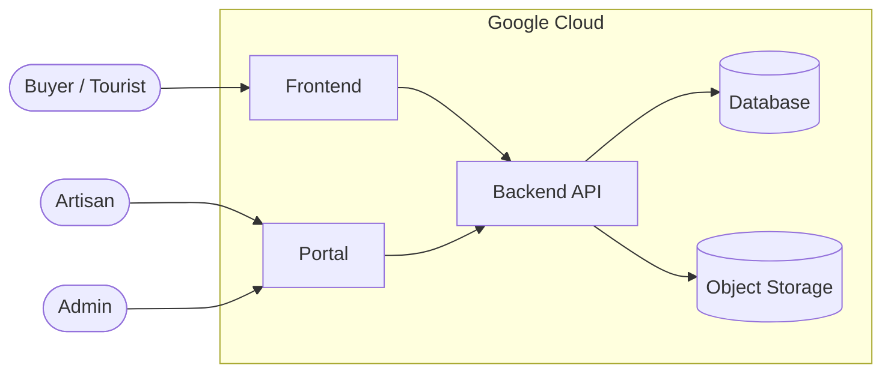

# Kiến trúc tổng thể

> Trạng thái: nháp — cập nhật khi nhóm chốt công nghệ (mục "Quyết định công nghệ").

## Sơ đồ

## Thành phần

| Thành phần | Người dùng | Trách nhiệm | Công nghệ |
|---|---|---|---|
| Frontend | Guest, Tourist, Buyer | Triển lãm số, bản đồ, trang QR, báo giá | TBD |
| Portal | Artisan, Admin | Quản lý xưởng, sản phẩm, lô, chào giá, kiểm duyệt, tin tức | TBD |
| Backend API | Frontend, Portal | Nghiệp vụ, xác thực, phân quyền, xử lý ảnh | TBD |
| Database | Backend | Lưu dữ liệu nghiệp vụ | TBD |
| Object storage | Backend, trình duyệt | Lưu ảnh gốc và ảnh đã resize | TBD |

## Triển khai (Google Cloud)

TBD — dịch vụ chạy app, cơ sở dữ liệu, lưu trữ ảnh.

CI (kiểm tra chất lượng trên mỗi Pull Request): xem [ci-cd.md](ci-cd.md).

## Quyết định công nghệ

Mỗi quyết định một dòng. Khi đổi ý, không xóa dòng cũ: ghi "Thay bởi #n" vào cột Trạng thái và thêm dòng mới.

| # | Ngày | Vấn đề | Phương án đã cân nhắc | Quyết định | Lý do | Trạng thái |
|---|---|---|---|---|---|---|
| 1 | | Framework Frontend / Portal | | | | Đang bàn |
| 2 | | Framework Backend | | | | Đang bàn |
| 3 | | Database | | | | Đang bàn |
| 4 | | Thư viện bản đồ (Google Maps / Leaflet) — UC bản đồ | | | | Đang bàn |
| 5 | | Nơi deploy trên Google Cloud | | | | Đang bàn |
| 6 | 2026-10-30 | CI/CD | Xem [ci-cd.md](ci-cd.md) | | | Đang bàn |
