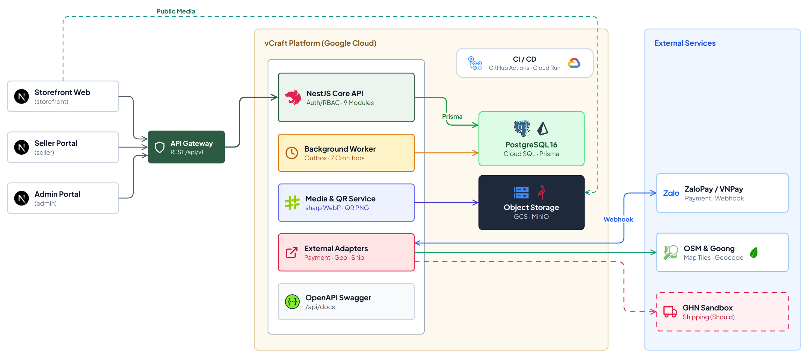
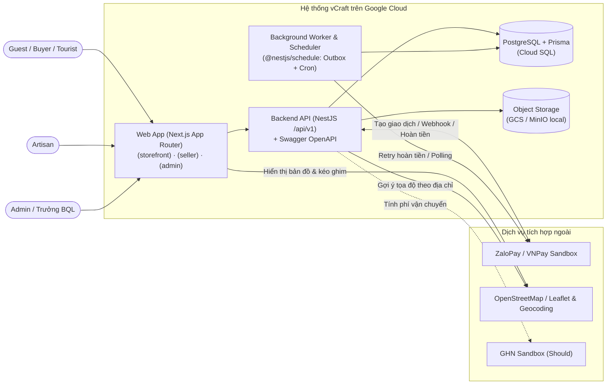

# Kiến trúc tổng thể

> Cập nhật: 2026-11-26 · Liên quan: [ERD](erd.md) · [Từ điển dữ liệu](data-dictionary.md) · [Đặc tả API](api.md) · [Danh mục mã lỗi](error-codes.md) · [Design System](design-system.md) · [CI/CD](ci-cd.md)

## 1. Sơ đồ kiến trúc

> Chỉnh sửa sơ đồ bằng cách mở trực tiếp [arch-components.drawio.png](../assets/arch-components.drawio.png) trong draw.io (Desktop hoặc VS Code Draw.io Integration) và lưu đè.

<!-- alt: Kiến trúc hệ thống vCraft. Sơ đồ kiến trúc theo tầng từ Storefront Web, Seller Portal, Admin Portal (Next.js) qua API Gateway vào vCraft Platform trên Google Cloud (NestJS Core API, Background Worker, Media & QR Service, External Adapters, OpenAPI Swagger, PostgreSQL 16 + Prisma, Object Storage GCS/MinIO, CI/CD GitHub Actions & Cloud Run) và các dịch vụ ngoài (ZaloPay/VNPay, OSM & Goong, GHN Sandbox). | edit in draw.io -->

Phiên bản Mermaid (xem nhanh dạng text/diff trong PR)

## 2. Thành phần hệ thống

| Thành phần | Đối tượng sử dụng | Nhiệm vụ chính | Công nghệ |
|---|---|---|---|
| **Web App (Storefront, Seller, Admin)** | Guest, Buyer, Artisan, Admin, Trưởng BQL | Một ứng dụng Next.js chia 3 route groups `(storefront)`, `(seller)`, `(admin)`; dùng chung phiên đăng nhập, hệ thống giao diện và chuông thông báo (UC-29). Hỗ trợ SSR cho trang chủ, sản phẩm, tin tức và trang QR công khai (UC-17) | Next.js (App Router, TypeScript), Tailwind CSS, `Arc UI`, `shadcn/ui`, `Lucide Icons`, `react-leaflet` |
| **Backend API** | Web App, Payment Webhook | Xử lý 35 UC theo chuẩn `/api/v1`, phiên đăng nhập server-side, phân quyền RBAC theo trạng thái hiện hành (`admin_grants`), khóa giao dịch đồng thời, lọc HTML (UC-27), sinh QR PNG, tạo thumbnail WebP và kiểm quyền tải tệp riêng tư | NestJS (TypeScript), `@nestjs/swagger`, `class-validator`, `sharp`, `qrcode` |
| **Background Worker & Scheduler** | Nội bộ | 1. **Transactional Outbox:** đẩy sự kiện từ `events` sang `notifications`, chống gửi trùng và gửi bù. 2. **7 nhóm Cron Job (UTC+7):** hủy đơn online quá 15 phút, hủy đơn chờ xác nhận quá 72 giờ, hủy đơn DR quá hạn cọc, tự hoàn tất sau 7 ngày giao, nhắc trước 24 giờ và đóng hết hạn RFQ/báo giá, đóng yêu cầu cập nhật giá quá hạn, thử lại hoàn tiền 5 bước (`1p → 5p → 15p → 1h → 6h`) | `@nestjs/schedule` (tách module `worker/` để có thể chạy thành tiến trình riêng khi cần) |
| **Database** | Backend, Worker | Lưu 28 bảng dữ liệu ([erd.md](erd.md), [data-dictionary.md](data-dictionary.md)); hỗ trợ ACID, khóa dòng (`SELECT ... FOR UPDATE`), cột `JSONB` cho bản chụp và tìm tiếng Việt không dấu (`unaccent`, `pg_trgm`) | PostgreSQL 16, Prisma ORM |
| **Object Storage** | Backend, Trình duyệt | Lưu ảnh gốc, thumbnail WebP và tệp đính kèm; tách kênh đọc công khai và kênh kiểm quyền (`/api/v1/assets/{id}/content`) cho giấy tờ hồ sơ (UC-01/02) và tệp tin nội bộ/nháp/ẩn (UC-27/28) | Google Cloud Storage (production), MinIO (cục bộ) |

## 3. Mẫu thiết kế áp dụng ở Backend

1. **Phân lớp theo module (`Controller → Service → Repository → Domain`):** Tách riêng lớp HTTP, luật nghiệp vụ và truy vấn CSDL.
2. **Repository & Unit of Work (Prisma):** Quản lý giao dịch (`$transaction`) và khóa bi quan theo thứ tự ID (`SELECT ... FOR UPDATE`) cho giữ tồn kho (UC-31), chấp nhận báo giá (UC-20), duyệt hồ sơ/địa chỉ (UC-02) và cập nhật lô (UC-14/15).
3. **Auth & Realtime RBAC Guards:** Kiểm tra phiên server-side, idle timeout, quyền bán của xưởng và nhóm quyền hiện hành của Admin trên từng request.
4. **Transactional Outbox (`events` → `notifications`):** Ghi sự kiện trong cùng giao dịch nghiệp vụ với `operation_key` duy nhất; worker đọc và tạo thông báo độc lập, không ảnh hưởng giao dịch nguồn.
5. **Adapter / Strategy cho dịch vụ ngoài (`IPaymentGateway`, `IGeocodingService`, `IStorageService`):** Tách lớp giao tiếp ZaloPay/VNPay, Nominatim/Goong và GCS/MinIO qua NestJS DI để dễ mock và thay thế.
6. **Explicit State Machine:** Kiểm soát chuyển trạng thái hợp lệ cho Đơn mua (8 trạng thái), Đơn đặt riêng (6 trạng thái), RFQ (6 trạng thái), Lô sản xuất (3 trạng thái) và Gian hàng (3 trạng thái).

## 4. Triển khai & CI/CD

- **Môi trường cục bộ (Phase 0):** `docker-compose.yml` dựng PostgreSQL 16 (bật sẵn `unaccent`, `pg_trgm`) và MinIO.
- **Môi trường triển khai:** Google Cloud Run (`frontend`, `backend`), Cloud SQL for PostgreSQL và Google Cloud Storage.
- **CI trên Pull Request:** Kiểm tra tiêu đề PR, Markdown lint và link nội bộ ([ci-cd.md](ci-cd.md)); bổ sung job lint, typecheck, test và build cho `frontend/` và `backend/` từ Phase 0.

## 5. Quyết định công nghệ (ADR)

Mỗi quyết định một dòng. Khi thay đổi, không xóa dòng cũ: ghi "Thay bởi #n" ở cột Trạng thái và thêm dòng mới.

| # | Ngày | Vấn đề | Phương án cân nhắc | Quyết định | Lý do | Trạng thái |
|---|---|---|---|---|---|---|
| 1 | 2026-11-26 | Framework Frontend & Portal | Next.js App Router, Vite + React Router | **Next.js (App Router, TypeScript) + Tailwind + Arc UI & shadcn/ui** | Tương thích trực tiếp `Arc UI`, gộp 3 khu vực trong 1 ứng dụng dùng chung Auth và `NotificationBell`, hỗ trợ SSR cho trang QR, tin tức và sản phẩm | Đã chốt |
| 2 | 2026-11-26 | Framework Backend & Worker | NestJS, Express/Hono, Spring Boot, FastAPI | **NestJS (TypeScript) + `@nestjs/schedule` + `@nestjs/swagger`** | Cùng ngôn ngữ TypeScript với Frontend; hỗ trợ sẵn cấu trúc Module/DI/Guard, Cron Scheduler và sinh tài liệu OpenAPI | Đã chốt |
| 3 | 2026-11-26 | Cơ sở dữ liệu & ORM | PostgreSQL (Prisma / TypeORM / Drizzle), MongoDB | **PostgreSQL 16 + Prisma ORM** | Hỗ trợ ACID, `SELECT ... FOR UPDATE`, Partial Unique Index, `JSONB`, `unaccent`/`pg_trgm` và truy vấn thống kê nhiều bảng; `schema.prisma` giúp đồng bộ cấu trúc bảng rõ ràng giữa các thành viên | Đã chốt |
| 4 | 2026-11-26 | Bản đồ & Geocoding (UC-25, 26) | Leaflet + OpenStreetMap, Google Maps API | **Leaflet (`react-leaflet`) + OpenStreetMap + Nominatim/Goong** | Miễn phí, không phụ thuộc hạn mức API trả phí, hỗ trợ kéo ghim và gom cụm marker; nút Chỉ đường dẫn sang Google Maps theo tọa độ | Đã chốt |
| 5 | 2026-11-26 | Lưu trữ tệp & xử lý ảnh | GCS, AWS S3, Local disk | **`sharp` (WebP thumbnail) + Google Cloud Storage (cục bộ dùng MinIO)** | Đồng bộ hạ tầng Google Cloud, tách riêng ảnh công khai và tệp cần kiểm quyền, chạy cục bộ độc lập qua Docker | Đã chốt |
| 6 | 2026-11-26 | Hạ tầng triển khai | Cloud Run, Compute Engine VM, GKE | **Google Cloud Run + Cloud SQL (PostgreSQL) + GCS** | Triển khai bằng Docker gọn nhẹ, tự giảm về 0 khi không có tải, có sẵn HTTPS cho webhook thanh toán | Đã chốt |
| 7 | 2026-10-30 | CI/CD | GitHub Actions | **GitHub Actions ([ci-cd.md](ci-cd.md))** | Tích hợp trực tiếp trên GitHub PR, tách job theo thư mục thay đổi | Đã chốt |
