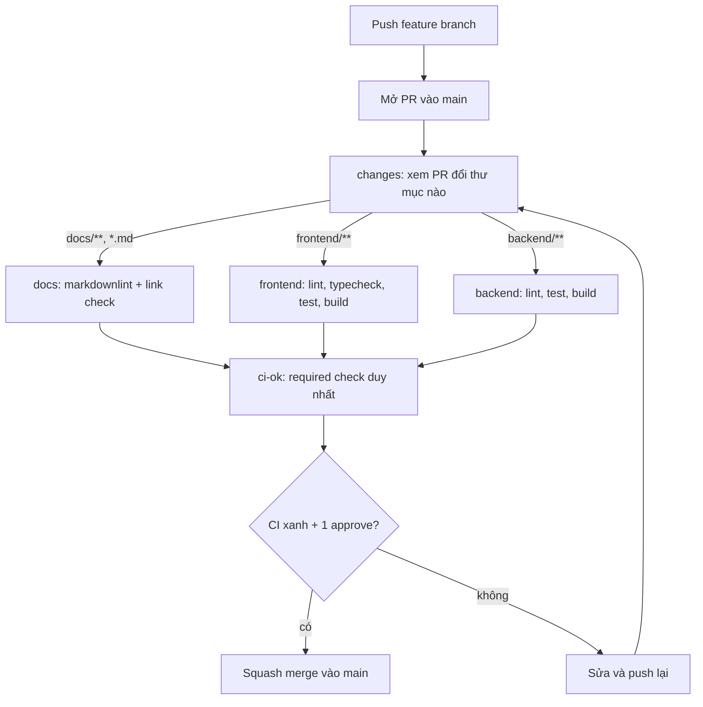

# CI/CD

> Trạng thái: đề xuất — cần cả nhóm review trước khi tạo workflow. Ghi kết quả vào bảng "Quyết định công nghệ" trong [architecture.md](architecture.md).

## Mục tiêu

CI chỉ làm một việc: **chặn code và tài liệu kém chất lượng vào `main`**. Mọi thay đổi phải qua Pull Request, và PR chỉ được merge khi CI xanh và có người review.

Không nằm trong phạm vi lúc này:

- Deploy tự động (CD) — thêm khi chốt nơi deploy (quyết định #5).
- Docker image, e2e test, coverage gate, SonarQube — thêm khi thật sự cần.

## Luồng làm việc



1. Mỗi việc làm trên một branch riêng, đặt tên theo loại: `docs/...`, `feat/...`, `fix/...`, `chore/...`.
2. Mở PR vào `main`. CI tự chạy trên mỗi lần push vào PR.
3. Job nào không liên quan đến thư mục bị đổi thì được bỏ qua (PR chỉ sửa docs không phải chờ build frontend).
4. Merge khi `ci-ok` xanh và có ít nhất 1 approve.

## Các job trong `.github/workflows/ci.yml`

| Job | Chạy khi đổi | Kiểm tra | Giai đoạn |
|---|---|---|---|
| `changes` | luôn chạy | `dorny/paths-filter` xác định thư mục bị đổi | 1 |
| `docs` | `docs/**`, `*.md` | `markdownlint-cli2` (format Markdown), `lychee --offline` (link nội bộ không gãy) | 1 |
| `frontend` | `frontend/**` | install (có cache), lint, format check, typecheck, unit test, build | 2 |
| `backend` | `backend/**` | lint, unit test, build | 2 |
| `ci-ok` | luôn chạy | Fail nếu có job nào fail hoặc bị hủy; job bị bỏ qua coi là pass | 1 |

Công cụ cụ thể cho `frontend` / `backend` (ESLint, Prettier, test runner...) chọn theo framework ở quyết định #1 và #2.

### Vì sao chỉ có một required check

Nếu đặt thẳng `frontend` làm required check, PR chỉ sửa docs sẽ bỏ qua job đó và PR có thể kẹt ở trạng thái chờ check. Job `ci-ok` luôn chạy, gom kết quả các job còn lại, nên branch protection chỉ cần nhớ một tên. Thêm job mới cũng không phải sửa cấu hình branch protection.

### Lưu ý cho job `docs`

- Tắt rule `MD013` (độ dài dòng): câu tiếng Việt và bảng thường dài.
- Link checker bỏ qua `docs/**/_template/**`: template chứa link mẫu như `../../brd/NN-<slug>/usecase.md`.
- Chạy `--offline` chỉ kiểm tra link nội bộ, nên nhanh và không fail vì website bên ngoài chập chờn. Tài liệu nối chéo nhiều (BRD ↔ SRS, UC → AC → TC), đổi tên thư mục rất dễ làm gãy link.

## Branch protection cho `main`

Cấu hình trong GitHub → Settings → Branches (hoặc Rulesets):

| Thiết lập | Giá trị |
|---|---|
| Bắt buộc Pull Request trước khi merge | Bật |
| Số approve tối thiểu | 1 |
| Required status check | `ci-ok` |
| Chặn force push và xóa branch | Bật |
| Kiểu merge cho phép | Chỉ squash merge |

Squash merge lấy tiêu đề PR làm commit message, nên mỗi PR là một commit trên `main` và history dễ đọc.

## Phần phụ (tùy chọn)

- **Kiểm tra tiêu đề PR** theo [Conventional Commits](https://www.conventionalcommits.org) (`docs:`, `feat:`, `fix:`, `chore:`) bằng `amannn/action-semantic-pull-request`. Vì dùng squash merge, chỉ cần kiểm tra tiêu đề PR thay vì từng commit.
- **Dependabot** cập nhật version GitHub Actions hằng tuần; thêm npm / Maven / pip khi có code.

## Lộ trình

| Giai đoạn | Khi nào | Việc cần làm |
|---|---|---|
| 1 | Ngay bây giờ (repo mới có tài liệu) | Tạo `ci.yml` với `changes`, `docs`, `ci-ok`; thêm `.markdownlint.jsonc`; bật branch protection |
| 2 | Khi chốt quyết định #1, #2 và có thư mục `frontend/`, `backend/` | Thêm job `frontend`, `backend` vào `ci.yml` và vào `needs` của `ci-ok` |
| 3 | Khi chốt quyết định #5 | Thiết kế CD (deploy lên Google Cloud) trong một tài liệu riêng |

## Phác thảo `ci.yml` giai đoạn 1

Bản phác thảo để review. Khi triển khai, kiểm tra lại version mới nhất của từng action.

```yaml
name: CI

on:
  pull_request:
    branches: [main]

concurrency:
  group: ci-${{ github.event.pull_request.number }}
  cancel-in-progress: true

jobs:
  changes:
    runs-on: ubuntu-latest
    outputs:
      docs: ${{ steps.filter.outputs.docs }}
    steps:
      - uses: actions/checkout@v5
      - uses: dorny/paths-filter@v3
        id: filter
        with:
          filters: |
            docs:
              - 'docs/**'
              - '**/*.md'

  docs:
    needs: changes
    if: needs.changes.outputs.docs == 'true'
    runs-on: ubuntu-latest
    steps:
      - uses: actions/checkout@v5
      - uses: DavidAnson/markdownlint-cli2-action@v20
        with:
          globs: '**/*.md'
      - uses: lycheeverse/lychee-action@v2
        with:
          args: --offline --no-progress --exclude-path 'docs/brd/_template' --exclude-path 'docs/srs/_template' '**/*.md'
          fail: true

  ci-ok:
    if: always()
    needs: [changes, docs]
    runs-on: ubuntu-latest
    steps:
      - name: Fail if any job failed or was cancelled
        if: contains(needs.*.result, 'failure') || contains(needs.*.result, 'cancelled')
        run: exit 1
```

## Câu hỏi mở

| Mã | Câu hỏi | Trạng thái |
|---|---|---|
| G-01 | Cần 1 hay 2 approve? Nhóm ít người thì 1 là đủ. | Mở |
| G-02 | Frontend, Portal, Backend để chung một repo (monorepo) hay tách repo? Đề xuất này giả định chung một repo. | Mở |
| G-03 | Có bật kiểm tra tiêu đề PR và Dependabot ngay từ giai đoạn 1 không? | Mở |
