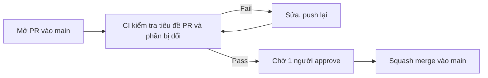

# CI/CD

> Trạng thái: đề xuất, chờ nhóm duyệt.

Frontend, Portal và Backend nằm chung repo này. Mỗi lần ai đó mở Pull Request vào `main`, GitHub Actions tự kiểm tra phần bị thay đổi. Chỉ merge được khi kiểm tra pass và có người approve. Chưa làm deploy tự động.

## Khi mở một Pull Request

1. Tạo branch riêng cho mỗi việc, đặt tên theo [quy ước](#đặt-tên-branch-và-pr).
2. Mở PR vào `main`, tiêu đề theo dạng `loại: mô tả`.
3. Đợi CI chạy xong. Fail thì xem log trong tab **Checks** của PR, sửa rồi push lại.
4. CI pass và có 1 approve thì squash merge.

## Đặt tên branch và PR

Branch và tiêu đề PR dùng chung một bộ loại:

| Loại | Dùng khi | Branch | Tiêu đề PR |
|---|---|---|---|
| `feat` | Thêm chức năng | `feat/uc-01-register` | `feat: đăng ký tài khoản Artisan` |
| `fix` | Sửa lỗi | `fix/upload-size` | `fix: chặn ảnh quá 10 MB` |
| `docs` | Tài liệu | `docs/uc-02` | `docs: thêm BRD UC-02` |
| `refactor` | Sửa code, không đổi hành vi | `refactor/media-service` | `refactor: tách xử lý ảnh khỏi controller` |
| `test` | Thêm hoặc sửa test | `test/uc-01` | `test: thêm test đăng ký Artisan` |
| `chore` | Cấu hình, CI, thư viện | `chore/ci` | `chore: thêm workflow CI` |

- **Branch:** `<loại>/<mô-tả-ngắn>`, chữ thường, nối bằng `-`. Làm theo use case thì ghi số UC (`uc-01`) để dễ nối với BRD/SRS. Tên branch không bị CI kiểm tra.
- **Tiêu đề PR:** `<loại>: <mô tả>`, mô tả tiếng Việt hoặc tiếng Anh đều được. CI kiểm tra tiêu đề; sai dạng thì PR không merge được. Sửa tiêu đề trên GitHub là đủ, không cần push lại code.

Tiêu đề PR quan trọng vì squash merge lấy nó làm commit message trên `main`.

## CI kiểm tra gì

Ngoài tiêu đề PR, CI chỉ chạy phần liên quan đến file bị đổi. PR chỉ sửa tài liệu sẽ không phải chờ build code.

| Sửa ở | CI kiểm tra |
|---|---|
| Mọi PR | Tiêu đề PR đúng dạng `<loại>: <mô tả>` |
| `docs/`, file `.md` | Format Markdown, link giữa các tài liệu không bị gãy |
| `frontend/` (khi có code) | Lint, kiểm tra kiểu, unit test, build |
| `backend/` (khi có code) | Lint, unit test, build |

Công cụ cụ thể cho frontend và backend chọn sau khi nhóm chốt framework.

## Quy tắc cho `main`

- Không push thẳng vào `main`, mọi thay đổi qua PR.
- Cần CI pass và 1 approve.
- Chỉ dùng squash merge: mỗi PR thành một commit, lấy tiêu đề PR làm commit message.

## Lộ trình

1. **Bây giờ:** bật kiểm tra tiêu đề PR, kiểm tra tài liệu và các quy tắc cho `main`.
2. **Khi có code:** thêm kiểm tra cho `frontend/` và `backend/`.
3. **Khi chốt nơi deploy:** bàn tiếp phần deploy tự động.
