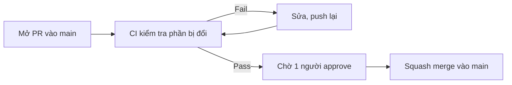

# CI/CD

> Trạng thái: đề xuất, chờ nhóm duyệt.

Frontend, Portal và Backend nằm chung repo này. Mỗi lần ai đó mở Pull Request vào `main`, GitHub Actions tự kiểm tra phần bị thay đổi. Chỉ merge được khi kiểm tra pass và có người approve. Chưa làm deploy tự động.

## Khi mở một Pull Request

1. Tạo branch riêng cho mỗi việc, ví dụ `docs/uc-02`, `feat/login`, `fix/upload`.
2. Mở PR vào `main`. Tiêu đề PR theo dạng `docs: ...`, `feat: ...`, `fix: ...`.
3. Đợi CI chạy xong. Fail thì xem log trong tab **Checks** của PR, sửa rồi push lại.
4. CI pass và có 1 approve thì squash merge.

## CI kiểm tra gì

CI chỉ chạy phần liên quan đến file bị đổi. PR chỉ sửa tài liệu sẽ không phải chờ build code.

| Sửa ở | CI kiểm tra |
|---|---|
| `docs/`, file `.md` | Format Markdown, link giữa các tài liệu không bị gãy |
| `frontend/` (khi có code) | Lint, kiểm tra kiểu, unit test, build |
| `backend/` (khi có code) | Lint, unit test, build |

Công cụ cụ thể cho frontend và backend chọn sau khi nhóm chốt framework.

## Quy tắc cho `main`

- Không push thẳng vào `main`, mọi thay đổi qua PR.
- Cần CI pass và 1 approve.
- Chỉ dùng squash merge: mỗi PR thành một commit, lấy tiêu đề PR làm commit message.

## Lộ trình

1. **Bây giờ:** bật kiểm tra tài liệu và các quy tắc cho `main`.
2. **Khi có code:** thêm kiểm tra cho `frontend/` và `backend/`.
3. **Khi chốt nơi deploy:** bàn tiếp phần deploy tự động.

## Cần nhóm quyết định

- Có bật kiểm tra tiêu đề PR tự động không?
- Có bật Dependabot (tự mở PR cập nhật thư viện) không?
