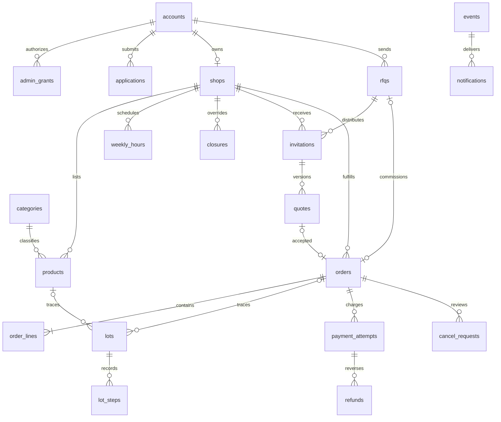

# Mô hình dữ liệu vCraft

Mô hình dữ liệu logic chính thức theo chín BRD tại `7e4e64b`. Sơ đồ thể hiện đường đi chính từ tài khoản đến đơn hàng. Từ điển bên dưới bổ sung dữ liệu hỗ trợ. [Hợp đồng giữa các nhóm](../srs/README.md)

## Từ điển dữ liệu

Mỗi thực thể có khóa chính `id`. Mũi tên chỉ khóa ngoại, dấu hỏi chỉ liên kết tùy chọn. Tiền dùng số nguyên VND, thời điểm lưu UTC và diễn giải lịch nghiệp vụ theo giờ Việt Nam. Ảnh lưu ở object storage. Tên bảng và cách lưu bản chụp mô tả thiết kế ở mức logic.

| Bảng | Trường và liên kết | Điều kiện toàn vẹn |
|---|---|---|
| `accounts` | email unique (không phân biệt hoa thường), password_hash, full_name, phone, account_type, admin_status, created_at | Tài khoản mua dùng tiếp khi bán. Trưởng BQL duy nhất được nạp sẵn. Admin thường có trạng thái Đang hoạt động hoặc Đã khóa. Khóa giữ nguyên các liên kết lịch sử. |
| `admin_grants` | account_id → accounts, permission_group | Duy nhất theo (account_id, permission_group). Admin thường có ít nhất một trong ba nhóm cố định của UC-34. Chỉ Trưởng BQL cấp quyền. |
| `sessions` | account_id → accounts, token_hash, last_active_at, revoked_at | Đổi mật khẩu thu hồi phiên khác. |
| `applications` | account_id → accounts, revision, status, shop_name, proposed_address, private_phone, started_year, intro, decision_reason, reviewer_id → accounts, decided_at | Lưu từng lần gửi và quyết định. Một hồ sơ hiện hành mỗi tài khoản. |
| `shops` | owner_id → accounts unique, application_id → applications, name, address, story, public_phones, status, accepts_requests, visit_mode, visit_note, latitude, longitude | Chỉ tạo gian hàng khi duyệt. Số điện thoại công khai do xưởng nhập riêng. |
| `shop_changes` | shop_id → shops, proposed_name, proposed_address, proposed_point, status, reviewer_id → accounts, reason | Mỗi yêu cầu đổi địa chỉ gồm ghim đề nghị. Duyệt cập nhật cả hai cùng lúc. |
| `certificates` | shop_id → shops, title, verification, verified_by → accounts, verified_at | Đổi nội dung hoặc ảnh thu hồi nhãn xác minh cũ. |
| `delivery_options` | shop_id → shops, method, fee, enabled | Phương thức giao và phí do gian hàng cấu hình, mỗi cặp xưởng/phương thức duy nhất. |
| `categories` | name, status, sort_order | Dùng chung cho sản phẩm, ghép yêu cầu, phân loại lô đặt riêng. |
| `products` | shop_id → shops, category_id → categories, name, description, kind, price, available_qty, visibility, ever_published | Số còn bán nguyên không âm, quản lý theo sản phẩm. |
| `weekly_hours` | shop_id → shops, weekday, opens, closes | Một khung giờ mỗi ngày cho một xưởng. |
| `closures` | shop_id → shops, start_at, end_at, whole_day, private_reason | Lịch tắt ưu tiên trước lịch tuần. Lý do chỉ chủ xưởng xem. |
| `rfqs` | buyer_id → accounts, source, target_shop_id → shops?, sample_product_id → products?, category_id → categories?, code, specifications, quantity, unit, recipient_snapshot, delivery_method, desired_date, first_sent_at, deadline, status, extension_count | Lưu nguồn gửi chung, riêng hoặc từ sản phẩm. Chụp thông tin mẫu và người nhận khi gửi. |
| `invitations` | rfq_id → rfqs, shop_id → shops, status, decline_reason, reminded_at, update_requested_at, update_deadline | Duy nhất (rfq_id, shop_id). Quyền đọc phản hồi thuộc Buyer và đúng xưởng. |
| `quotes` | invitation_id → invitations, revision, unit_price, shipping_fee, lead_time, deposit_percent, valid_until, status, terms | Duy nhất (invitation_id, revision). Mỗi lời mời chỉ một phiên bản hiện hành. |
| `orders` | buyer_id → accounts, shop_id → shops, kind, code unique, rfq_id → rfqs?, quote_id → quotes?, state, payment_state, recipient_snapshot, delivery_snapshot, amount, deposit_due, balance_collected_at, created_at, delivered_at | Đơn đặt riêng bắt buộc RFQ và phiên bản giá cùng lời mời trúng. RFQ duy nhất trong các đơn đặt riêng. Đơn mua tạo từ checkout một xưởng. |
| `order_lines` | order_id → orders, product_id → products?, product_snapshot, specification, quantity, unit_price, restocked_qty | Bản chụp giá, ảnh, tên và lượng mua. Dòng đặt riêng lưu quy cách chốt. |
| `cart_items` | account_id → accounts, product_id → products, quantity, selected | Khóa duy nhất theo tài khoản và sản phẩm. Giỏ Guest lưu ở trình duyệt. |
| `payment_attempts` | order_id → orders, provider, reference unique, purpose, amount, status, expires_at | Tách lần thử trả toàn đơn hoặc cọc. Hạn đơn online mua sẵn tính từ lần tạo đơn. |
| `refunds` | payment_id → payment_attempts, reason, amount, provider_ref, state, next_retry_at | Chống hoàn lặp cùng khoản thu và nguyên nhân. Chỉ ghi đã hoàn sau khi cổng xác nhận. |
| `cancel_requests` | order_id → orders, requester_id → accounts, reason, state, decision_reason, resolved_at | Mỗi đơn tối đa một yêu cầu đang chờ, có thể rút. |
| `order_events` | order_id → orders, actor_id → accounts?, action, from_state, to_state, reason, occurred_at | Ghi thao tác người dùng hoặc hệ thống. Phân biệt tiến độ, thanh toán và yêu cầu hủy. |
| `lots` | shop_id → shops, product_id → products?, order_id → orders?, category_id → categories, code unique, qr_token unique, name, quantity, state, list_on_product | Chính xác một nguồn sản phẩm hoặc đơn đặt riêng thuộc cùng xưởng. Một đơn có nhiều lô, URL QR cố định. |
| `lot_steps` | lot_id → lots, title, body, occurred_at, position, updated_at | Quyền sửa phụ thuộc vòng đời lô. |
| `corrections` | lot_id → lots, step_id → lot_steps?, body, created_at | Ghi chú đính chính tách khỏi nội dung đã khóa. |
| `articles` | author_id → accounts, title, category, rich_body, audience, state, first_published_at, updated_at | Tách phạm vi nội bộ/công khai khỏi trạng thái xuất bản. Kiểm tra quyền cả khi tải tệp. |
| `assets` | object_key unique, thumbnail_key, mime, size, owner_kind, owner_id, purpose, position | Ảnh và tệp gắn hồ sơ, chứng nhận, xưởng, sản phẩm, RFQ, mốc hoặc bài viết. Kiểm tra quyền qua chủ thể. Khi triển khai dùng FK riêng theo loại hoặc bảng liên kết. |
| `events` | kind, subject_type, subject_id, operation_key unique, actor_id → accounts?, before_state, after_state, occurred_at, recipients_snapshot | Ghi sự kiện trong giao dịch nguồn. Dùng khóa riêng cho từng lần chuyển trạng thái hợp lệ. |
| `notifications` | event_id → events, user_id → accounts, template, area, target_type, target_id, title, body, read_at | Duy nhất theo cặp (event_id, user_id). Mở đích kiểm tra lại quyền. |

## Ranh giới giao dịch

- Duyệt hồ sơ và cấp gian hàng trong một lần ghi. Quyền mua gắn với tài khoản hiện có. Duyệt đổi địa chỉ ghi địa chỉ và ghim trong cùng giao dịch.
- Chấp nhận báo giá khóa RFQ, kiểm tra phiên bản, hiệu lực, chủ sở hữu và trạng thái theo UC-20. Ghi đơn, bản chụp, đóng các báo giá còn lại và ghi sự kiện cùng nhau. Cọc được xử lý sau khi tạo đơn. Tồn kho sản phẩm áp dụng cho đơn mua sẵn.
- Checkout khóa các sản phẩm theo thứ tự ID, kiểm lại giá, số còn bán và trạng thái xưởng, trừ tồn toàn bộ rồi tạo đơn và bỏ đúng các món đã đặt khỏi giỏ. Khóa thao tác lặp theo Buyer và yêu cầu checkout.
- Callback thanh toán, hết hạn và hủy cùng khóa đơn. Khoản thu đến muộn gắn với đơn đã hủy để hoàn đúng giao dịch. Việc hoàn tồn ghi cùng thay đổi trạng thái đơn. Yêu cầu hoàn tiền được lưu bền vững trước khi gọi cổng sandbox.
- Phát thông báo từ sự kiện đã commit. Khi đọc lại hoặc gửi bù, dùng khóa chống trùng của notifications. Trường hợp đơn đặt riêng đã hủy vẫn giữ lô, QR và lịch sử đã tạo.

## Quyền quản trị và dữ liệu giám sát

UC-34 thay tập quyền trong một giao dịch. Mỗi thao tác đọc quyền hiện tại. Khi khóa tài khoản hoặc đặt lại mật khẩu, thu hồi toàn bộ phiên của Admin trong cùng giao dịch. Mở khóa yêu cầu đăng nhập lại.

UC-35 dùng truy vấn chỉ đọc trên dữ liệu nghiệp vụ. Lưu first_sent_at đúng một lần khi gửi RFQ lần đầu. Thống kê theo orders.created_at hoặc rfqs.first_sent_at và trạng thái hiện tại, dùng ngày Việt Nam. Truy vấn số đơn chờ hoàn đếm ID đơn phân biệt còn nghĩa vụ hoàn tiền trên toàn bộ lịch sử, kể cả đơn ngoài kỳ. Khi nối báo giá, lô và các lần thử thanh toán, tổng hợp từng đơn trước để tránh nhân doanh số.
