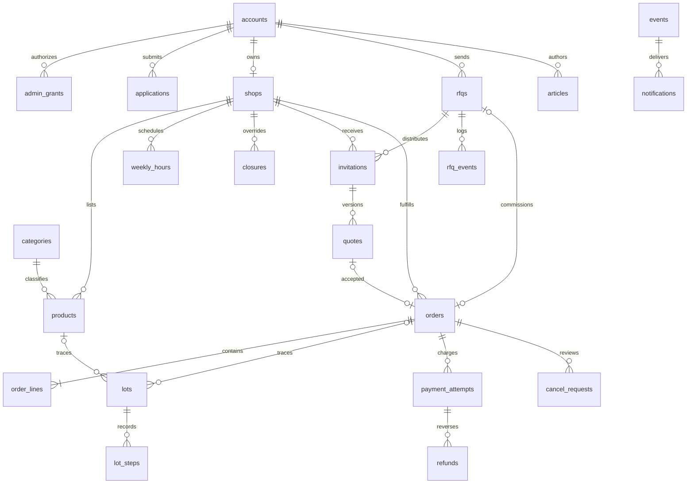

# Mô hình dữ liệu vCraft

Mô hình dữ liệu logic chính thức theo chín BRD tại `7e4e64b` (đã đồng bộ 26/11/2026). Sơ đồ thể hiện đường đi chính từ tài khoản đến đơn hàng. Chi tiết kiểu dữ liệu, độ dài, Enum, validation và phạm vi hiển thị API của từng cột xem tại [Từ điển dữ liệu chi tiết (Data Dictionary)](data-dictionary.md). [Hợp đồng giữa các nhóm](../srs/README.md)

## Từ điển dữ liệu

Mỗi thực thể có khóa chính `id`. Mũi tên chỉ khóa ngoại, dấu hỏi chỉ liên kết hoặc cột tùy chọn (nullable). Tiền dùng số nguyên VND, thời điểm lưu UTC và diễn giải lịch nghiệp vụ theo giờ Việt Nam (`Asia/Ho_Chi_Minh`). Ảnh và tệp lưu ở object storage. Tên bảng và cách lưu bản chụp mô tả thiết kế ở mức logic.

| Bảng | Trường và liên kết | Điều kiện toàn vẹn |
|---|---|---|
| `accounts` | email unique (không phân biệt hoa thường), password_hash?, full_name, phone, account_type (`BUYER` \| `ARTISAN` \| `ADMIN` \| `SUPER_ADMIN`), admin_status? (`ACTIVE` \| `LOCKED`), failed_login_attempts, locked_until?, created_at | Tài khoản mua dùng tiếp khi bán (`BUYER` → `ARTISAN`). Đúng một `SUPER_ADMIN` (Trưởng BQL) duy nhất (ràng buộc partial unique). `password_hash` nullable nếu dùng Google OAuth. Khóa tạm 15 phút sau 5 lần sai (`failed_login_attempts`, `locked_until`). Khóa Admin giữ nguyên các liên kết lịch sử. |
| `admin_grants` | account_id → accounts, permission_group (`MODERATION_CATALOG` \| `NEWS` \| `TRANSACTION_MONITORING`) | Duy nhất theo `(account_id, permission_group)`. Admin thường có ít nhất một trong ba nhóm cố định của UC-34. Chỉ Trưởng BQL cấp quyền. |
| `sessions` | account_id → accounts, token_hash unique, last_active_at, expires_at, revoked_at? | Kiểm tra idle timeout (đề xuất 7 ngày Buyer/Artisan, 2 giờ Admin). Đổi mật khẩu thu hồi phiên khác; khóa/reset mật khẩu Admin thu hồi toàn bộ phiên. |
| `applications` | account_id → accounts, revision, status (`DRAFT` \| `PENDING` \| `NEEDS_REVISION` \| `APPROVED` \| `REJECTED`), shop_name, proposed_address, private_phone, started_year, intro, decision_reason?, reviewer_id → accounts?, created_at, submitted_at?, decided_at? | Duy nhất theo `(account_id, revision)`. Tối đa một hồ sơ đang hoạt động (`DRAFT`/`PENDING`/`NEEDS_REVISION`) mỗi tài khoản. Sắp xếp hàng chờ duyệt theo `submitted_at` tăng dần. |
| `shops` | owner_id → accounts unique, application_id → applications, name, slug unique, address, started_year, story, public_phones, status (`PREPARING` \| `ACTIVE` \| `PAUSED`), accepts_requests, visit_mode, visit_note, latitude?, longitude?, first_opened_at?, created_at | Chỉ tạo gian hàng khi duyệt hồ sơ. `first_opened_at` ghi đúng một lần khi chuyển `PREPARING` → `ACTIVE` (không đổi khi mở lại sau `PAUSED`). Số điện thoại công khai do xưởng nhập riêng. |
| `shop_changes` | shop_id → shops, proposed_name?, proposed_address?, proposed_latitude?, proposed_longitude?, status (`PENDING` \| `APPROVED` \| `REJECTED`), reviewer_id → accounts?, reason?, created_at, decided_at? | Tối đa một yêu cầu `PENDING` mỗi xưởng. Yêu cầu đổi địa chỉ bắt buộc kèm `(proposed_latitude, proposed_longitude)`. Duyệt cập nhật tên/địa chỉ/tọa độ trong cùng giao dịch. |
| `certificates` | shop_id → shops, title, verification (`SELF_PROVIDED` \| `VERIFIED`), verified_by → accounts?, verified_at?, version, updated_at | Đổi nội dung hoặc ảnh thu hồi nhãn xác minh cũ và tăng `version`. Admin xác minh kiểm tra `version` chống race condition (`ERR-UC02-02`). |
| `delivery_options` | shop_id → shops, method, fee, enabled | Phương thức giao và phí do gian hàng cấu hình, mỗi cặp `(shop_id, method)` duy nhất. |
| `categories` | name unique (không phân biệt hoa thường), status (`PUBLISHED` \| `HIDDEN`), sort_order | Dùng chung cho sản phẩm, ghép yêu cầu báo giá và phân loại lô đặt riêng. |
| `products` | shop_id → shops, category_id → categories?, name, slug unique, description, kind (`READY` \| `CUSTOM_ONLY`), price?, available_qty, visibility (`DRAFT` \| `PUBLISHED` \| `HIDDEN`), ever_published, weight_gram?, length_cm?, width_cm?, height_cm?, created_at | `category_id` nullable khi `visibility = DRAFT`, bắt buộc khi `PUBLISHED`. `available_qty` nguyên không âm, khóa khi checkout (UC-31). |
| `weekly_hours` | shop_id → shops, weekday (1..7), enabled, opens, closes | Duy nhất theo `(shop_id, weekday)`. Cờ `enabled` giữ nguyên giờ cũ khi tắt/bật từng ngày (UC-25 Alt-05). |
| `closures` | shop_id → shops, start_date, end_date, start_time?, end_time?, whole_day, private_reason? | Lưu được cả nghỉ trọn ngày (`whole_day = true`) và nghỉ lặp theo khung giờ `[start_time, end_time)` cho từng ngày trong khoảng `[start_date, end_date]` (UC-25 BR-9). Lịch tắt ưu tiên trước lịch tuần. Lý do chỉ chủ xưởng xem. |
| `rfqs` | buyer_id → accounts, source, target_shop_id → shops?, sample_product_id → products?, sample_product_snapshot?, category_id → categories?, code unique, specifications, quantity, unit, recipient_snapshot, delivery_method, desired_date, first_sent_at?, deadline, status, extension_count, expired_reason?, cancel_reason?, created_at | Lưu nguồn gửi chung, riêng hoặc từ sản phẩm. Chụp `sample_product_snapshot` (tên, ảnh) và `recipient_snapshot` khi gửi. |
| `rfq_events` | rfq_id → rfqs, actor_id → accounts?, action, from_state?, to_state, reason?, occurred_at | Ghi lịch sử chuyển trạng thái, gia hạn, hủy và hết hạn của RFQ (UC-18 BR-12, UC-21). |
| `invitations` | rfq_id → rfqs, shop_id → shops, status, decline_reason?, decline_note?, reminded_at?, update_request_status? (`PENDING` \| `FULFILLED` \| `REJECTED` \| `EXPIRED`), update_requested_at?, update_deadline? | Duy nhất `(rfq_id, shop_id)`. Quyền đọc phản hồi thuộc Buyer và đúng xưởng. |
| `quotes` | invitation_id → invitations, revision, unit_price, shipping_fee, lead_time, deposit_percent, deposit_deadline_days?, valid_until, status, terms?, reminded_at?, created_at | Duy nhất `(invitation_id, revision)`. Mỗi lời mời chỉ một phiên bản hiện hành. `deposit_deadline_days` do xưởng tự đặt trong `1..14` ngày (mặc định 3) khi cọc > 0%, để trống khi cọc 0%. `reminded_at` đảm bảo chỉ nhắc Buyer 1 lần trước 24h. |
| `orders` | buyer_id → accounts, shop_id → shops, kind (`READY` \| `CUSTOM`), code unique, rfq_id → rfqs?, quote_id → quotes?, state, payment_method?, payment_state, delivery_method, recipient_snapshot, delivery_snapshot, note?, shipping_note?, amount, deposit_due, payment_due_at?, deposit_due_at?, confirm_due_at?, balance_collected_at?, idempotency_key?, created_at, delivered_at? | Đơn đặt riêng (`CUSTOM`) bắt buộc `rfq_id` (unique trong các đơn đặt riêng) và `quote_id` cùng lời mời trúng, `payment_method` để trống; nếu cọc > 0% chụp cứng `deposit_due_at = created_at + deposit_deadline_days`. Đơn mua (`READY`) bắt buộc `payment_method` (`COD` \| `ZALOPAY`), chụp `payment_due_at` (+15p với online) và `confirm_due_at` (+72h từ lúc vào `Chờ xác nhận`), unique `(buyer_id, idempotency_key)`. |
| `order_lines` | order_id → orders, product_id → products?, product_snapshot, specification?, quantity, unit_price, restocked_qty | Bản chụp giá, ảnh, tên và lượng mua. Dòng đặt riêng lưu quy cách chốt. |
| `cart_items` | account_id → accounts, product_id → products, quantity | Duy nhất theo `(account_id, product_id)`. Trạng thái chọn món (`selected`) lưu ở client-state theo BRD UC-30; giỏ Guest lưu ở trình duyệt. |
| `payment_attempts` | order_id → orders, provider, reference unique, purpose (`FULL_ORDER` \| `DEPOSIT`), amount, status, expires_at?, created_at | Tách lần thử trả toàn đơn hoặc cọc. Hạn đơn online mua sẵn tính từ lần tạo đơn. |
| `refunds` | payment_id → payment_attempts, reason, idempotency_key unique, amount, provider_ref?, state (`PENDING` \| `SUCCEEDED` \| `FAILED`), retry_count, next_retry_at?, last_error?, created_at, updated_at | `idempotency_key` duy nhất theo `(payment_id, reason)`; tra cứu trạng thái cổng trước mỗi lần thử lại (tối đa 5 lần: `1p → 5p → 15p → 1h → 6h`). Lỗi vĩnh viễn hoặc hết ngưỡng chuyển `refunds.state = FAILED`, giữ nguyên `orders.state` và `payment_state`, tính vào tồn đọng UC-35. |
| `cancel_requests` | order_id → orders, requester_id → accounts, reason, state, deposit_handling? (`KEEP` \| `REFUND`), decision_reason?, resolved_by → accounts?, created_at, resolved_at? | Mỗi đơn tối đa một yêu cầu đang chờ, có thể rút. `deposit_handling` ghi quyết định giữ/hoàn cọc khi xưởng đồng ý hủy đơn DR có cọc. |
| `order_events` | order_id → orders, actor_id → accounts?, action, from_state?, to_state, reason?, occurred_at | Ghi thao tác người dùng hoặc hệ thống. Phân biệt tiến độ, thanh toán và yêu cầu hủy. |
| `lots` | shop_id → shops, product_id → products?, order_id → orders?, category_id → categories, code unique, qr_token unique, name, description?, start_date, quantity, state (`IN_PROGRESS` \| `COMPLETED` \| `SHIPPED`), ever_completed, reopened_at?, list_on_product, created_at | Chính xác một nguồn `product_id` hoặc `order_id` thuộc cùng xưởng. Lô của sản phẩm sao chép `category_id` từ sản phẩm lúc tạo. Một đơn DR có nhiều lô; URL QR công khai cố định dùng `qr_token`. |
| `lot_steps` | lot_id → lots, title, body, step_date, position, is_edited, created_at, updated_at | Sắp xếp theo `step_date` tăng dần, cùng ngày xếp theo `created_at`/`position`. `is_edited = true` nếu sửa/thêm sau khi `lots.ever_completed = true`. |
| `corrections` | lot_id → lots, step_id → lot_steps?, body, created_at | Ghi chú đính chính bất biến ở mức lô (tách khỏi nội dung mốc đã khóa). |
| `articles` | author_id → accounts, published_by → accounts?, title, category?, rich_body?, audience (`PUBLIC` \| `INTERNAL`), state (`DRAFT` \| `PUBLISHED` \| `HIDDEN`), version, first_published_at?, content_updated_at?, created_at, updated_at | `category` và `rich_body` nullable khi `state = DRAFT`. `version` dùng optimistic locking (`ERR-UC27-05`). `content_updated_at` chỉ cập nhật khi sửa nội dung sau khi đã đăng (không đổi khi Ẩn/Đăng lại). |
| `assets` | object_key unique, thumbnail_key?, original_filename, mime, size, owner_kind, owner_id?, purpose, position, created_at | Ảnh và tệp gắn hồ sơ, chứng nhận, xưởng, sản phẩm, RFQ, mốc hoặc bài viết. `owner_id` nullable tạm cho upload xem trước tin chưa lưu nháp (dọn bằng job orphan). Kiểm tra quyền tải theo chủ thể (không expose URL tĩnh với ảnh minh chứng UC-01/02 và tệp tin nội bộ/nháp/ẩn UC-27/28). |
| `events` | kind, subject_type, subject_id, operation_key unique, actor_id → accounts?, before_state?, after_state?, occurred_at, recipients_snapshot, dispatch_status (`PENDING` \| `DISPATCHED` \| `FAILED`), dispatched_at?, retry_count | Ghi sự kiện trong giao dịch nguồn (Transactional Outbox). Worker bất đồng bộ đọc `dispatch_status = PENDING` để fan-out sang `notifications` và hỗ trợ gửi bù không chạy lại nghiệp vụ nguồn. |
| `notifications` | event_id → events, user_id → accounts, template, area (`BUYER` \| `SELLER` \| `ADMIN`), target_type, target_id, title, body, read_at?, created_at | Duy nhất theo cặp `(event_id, user_id)`. Đánh index `(user_id, created_at DESC)` và `(user_id, read_at)` cho phân trang và polling `unread-count`. Mở đích kiểm tra lại quyền hiện tại. |

## Ranh giới giao dịch

- Duyệt hồ sơ và cấp gian hàng trong một lần ghi. Quyền mua gắn với tài khoản hiện có. Duyệt đổi địa chỉ ghi địa chỉ và ghim trong cùng giao dịch.
- Chấp nhận báo giá khóa RFQ, kiểm tra phiên bản, hiệu lực, chủ sở hữu và trạng thái theo UC-20. Ghi đơn, bản chụp, đóng các báo giá còn lại và ghi sự kiện cùng nhau. Cọc được xử lý sau khi tạo đơn. Tồn kho sản phẩm áp dụng cho đơn mua sẵn.
- Checkout khóa các sản phẩm theo thứ tự ID, kiểm lại giá, số còn bán và trạng thái xưởng, trừ tồn toàn bộ rồi tạo đơn và bỏ đúng các món đã đặt khỏi giỏ. Khóa thao tác lặp theo Buyer và yêu cầu checkout.
- Callback thanh toán, hết hạn và hủy cùng khóa đơn. Khoản thu đến muộn gắn với đơn đã hủy để hoàn đúng giao dịch. Việc hoàn tồn ghi cùng thay đổi trạng thái đơn. Yêu cầu hoàn tiền được lưu bền vững trước khi gọi cổng sandbox.
- Phát thông báo từ sự kiện đã commit. Khi đọc lại hoặc gửi bù, dùng khóa chống trùng của notifications. Trường hợp đơn đặt riêng đã hủy vẫn giữ lô, QR và lịch sử đã tạo.

## Quyền quản trị và dữ liệu giám sát

UC-34 thay tập quyền trong một giao dịch. Mỗi thao tác đọc quyền hiện tại. Khi khóa tài khoản hoặc đặt lại mật khẩu, thu hồi toàn bộ phiên của Admin trong cùng giao dịch. Mở khóa yêu cầu đăng nhập lại.

UC-35 dùng truy vấn chỉ đọc trên dữ liệu nghiệp vụ. Lưu first_sent_at đúng một lần khi gửi RFQ lần đầu. Thống kê theo orders.created_at hoặc rfqs.first_sent_at và trạng thái hiện tại, dùng ngày Việt Nam. Truy vấn số đơn chờ hoàn đếm ID đơn phân biệt còn nghĩa vụ hoàn tiền trên toàn bộ lịch sử, kể cả đơn ngoài kỳ. Khi nối báo giá, lô và các lần thử thanh toán, tổng hợp từng đơn trước để tránh nhân doanh số.
