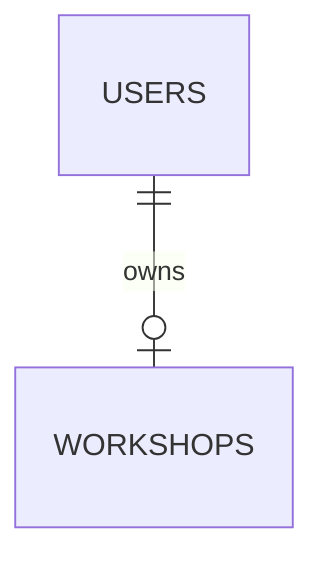

# ERD và Schema

> Trạng thái: chưa bắt đầu.

## Sơ đồ ERD

## Danh sách bảng

| Bảng | Mô tả | Ghi chú |
|---|---|---|
| | | |

## Chi tiết bảng

### `<ten_bang>`

| Cột | Kiểu | Ràng buộc | Mô tả |
|---|---|---|---|
| id | | PK | |
