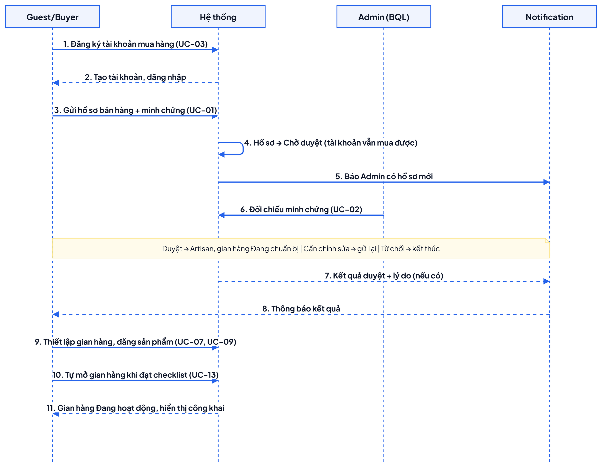
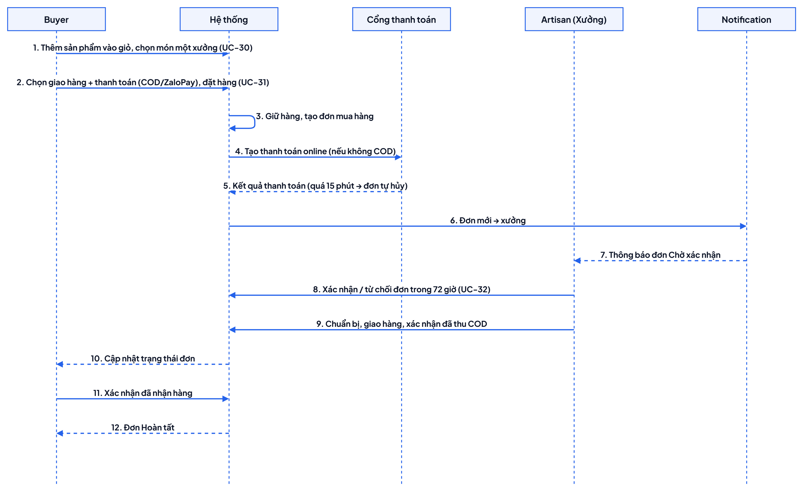
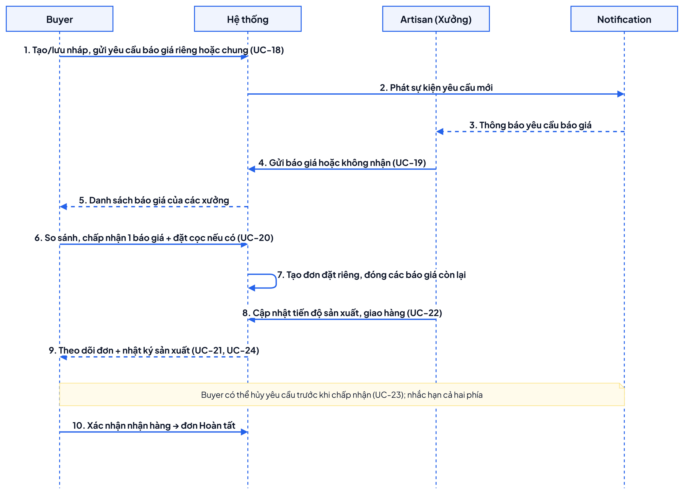
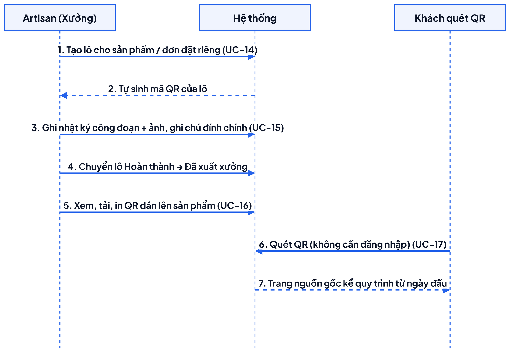
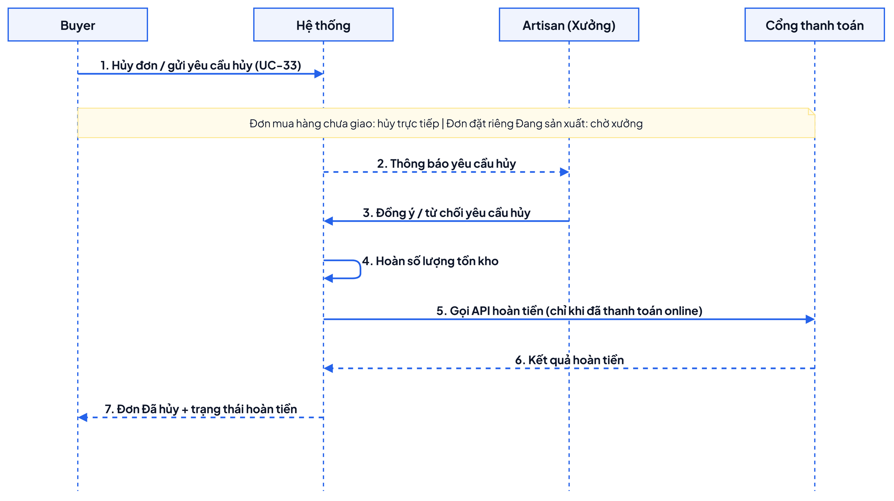
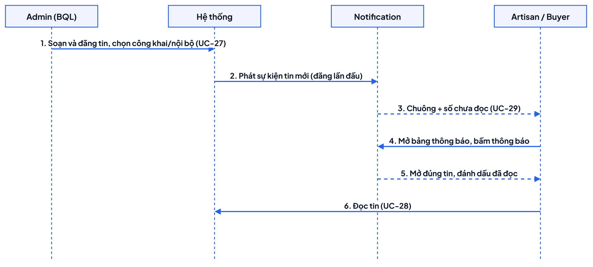
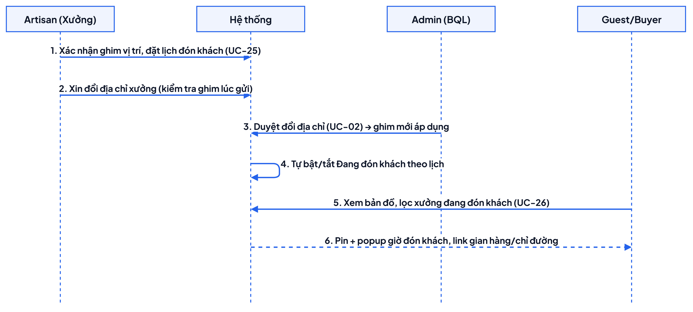
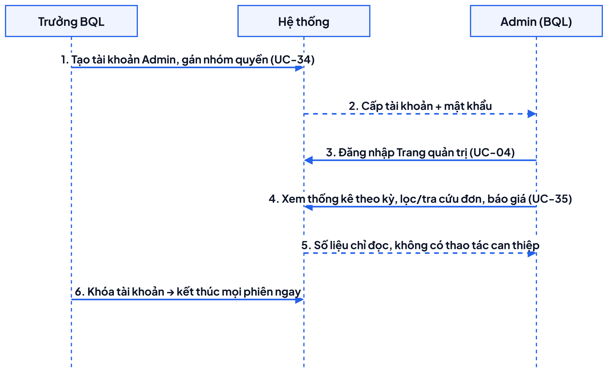

# Overview hệ thống VCraft

Tài liệu tổng quan được tổng hợp từ BRD trong [docs/brd](brd/). Sơ đồ tuần tự ở dạng draw.io (mxGraph XML).

> [!NOTE]
> Mỗi sơ đồ là file `.drawio.png`: mở bằng draw.io (desktop, app.diagrams.net, VS Code Draw.io Integration) để sửa rồi lưu lại, ảnh tự cập nhật.

## 1. Tổng quan

VCraft là sàn thương mại số của làng nghề: mỗi xưởng có gian hàng và sản phẩm riêng, khách mua sản phẩm có sẵn hoặc đặt làm riêng qua báo giá, truy xuất nguồn gốc bằng QR, xem bản đồ làng nghề. Ban quản lý (BQL) kiểm duyệt hộ bán hàng, đăng tin tức và giám sát giao dịch.

### 1.1 Vai trò

| Vai trò | Mô tả | Khu vực |
|---|---|---|
| Guest | Chưa đăng nhập; xem trang chủ, xưởng, sản phẩm, bản đồ, QR, tin công khai; có giỏ hàng | Khu mua hàng |
| Buyer | Tài khoản mua hàng; đặt hàng, yêu cầu báo giá, hủy đơn | Khu mua hàng |
| Artisan | Buyer đã được duyệt hồ sơ bán hàng; quản lý gian hàng, sản phẩm, đơn, lô sản xuất | Kênh người bán |
| Admin | Cán bộ BQL, tài khoản tách biệt (không mua, không bán); theo nhóm quyền | Trang quản trị |
| Trưởng BQL | Super Admin; duy nhất được quản lý tài khoản Admin | Trang quản trị |

### 1.2 Nhóm chức năng

| Nhóm | Thư mục BRD | Use case | Nội dung chính |
|---|---|---|---|
| 01 Tài khoản | [01-account](brd/01-account/usecase.md) | UC-01 → UC-05 | Đăng ký, đăng nhập, hồ sơ bán hàng, kiểm duyệt, thông tin tài khoản |
| 02 Triển lãm số | [02-showcase](brd/02-showcase/usecase.md) | UC-06 → UC-13 | Trang chủ, gian hàng, sản phẩm, phân loại, mở/tạm ngừng gian hàng |
| 03 Truy xuất nguồn gốc | [03-traceability](brd/03-traceability/usecase.md) | UC-14 → UC-17 | Lô sản xuất, nhật ký, QR |
| 04 Báo giá | [04-quotation](brd/04-quotation/usecase.md) | UC-18 → UC-24 | Yêu cầu báo giá, báo giá, đơn đặt riêng |
| 05 Bản đồ làng nghề | [05-village-map](brd/05-village-map/usecase.md) | UC-25 → UC-26 | Vị trí xưởng, lịch đón khách, bản đồ |
| 06 Tin tức | [06-news](brd/06-news/usecase.md) | UC-27 → UC-28 | Đăng, đọc tin công khai/nội bộ |
| 07 Thông báo | [07-notification](brd/07-notification/usecase.md) | UC-29 | Chuông, số chưa đọc, mở đúng đối tượng |
| 08 Đơn hàng | [08-order](brd/08-order/usecase.md) | UC-30 → UC-33 | Giỏ hàng, checkout, quản lý đơn, hủy/hoàn tiền |
| 09 Quản trị & giám sát | [09-portal](brd/09-portal/usecase.md) | UC-34 → UC-35 | Tài khoản Admin, phân quyền, thống kê, giám sát |

### 1.3 Quy tắc nghiệp vụ xuyên suốt

- Mỗi người dùng một tài khoản, một phiên đăng nhập; quyền bán là quyền thêm vào tài khoản mua hàng sau khi BQL duyệt.
- Mỗi đơn do đúng một xưởng thực hiện toàn bộ số lượng; MVP1 không thu phí sàn, không đối soát tiền.
- Thanh toán: COD hoặc ZaloPay (sandbox); hạn thanh toán online 15 phút; xưởng xác nhận trong 72 giờ.
- Báo giá kín: Buyer thấy mọi báo giá, xưởng chỉ thấy báo giá của mình.
- Admin không can thiệp giao dịch, chỉ giám sát chỉ đọc (UC-35).
- Thông báo chỉ nằm trong hệ thống; sự kiện phát thông báo do từng use case khai báo.

## 2. Sơ đồ tuần tự

### Luồng 1 — Từ khách đến người bán có gian hàng (UC-03, 01, 02, 07, 09, 13)

Guest tạo tài khoản mua hàng, gửi hồ sơ bán hàng, BQL duyệt, hộ chuẩn bị gian hàng rồi tự mở gian hàng. Gian hàng chỉ hiển thị công khai sau khi mở.

<!-- alt: Luồng 1 — Từ khách đến người bán có gian hàng (UC-03, 01, 02, 07, 09, 13). Guest tạo tài khoản mua hàng, gửi hồ sơ bán hàng, BQL duyệt, hộ chuẩn bị gian hàng rồi tự mở gian hàng. Gian hàng chỉ hiển thị công khai sau khi mở. | edit in draw.io -->

### Luồng 2 — Mua sản phẩm có sẵn (UC-30, 31, 32)

Thêm giỏ không giữ hàng; hệ thống chỉ giữ hàng khi đặt hàng. Xưởng có 72 giờ để xác nhận; thanh toán online có hạn 15 phút.

<!-- alt: Luồng 2 — Mua sản phẩm có sẵn (UC-30, 31, 32). Thêm giỏ không giữ hàng; hệ thống chỉ giữ hàng khi đặt hàng. Xưởng có 72 giờ để xác nhận; thanh toán online có hạn 15 phút. | edit in draw.io -->

### Luồng 3 — Yêu cầu báo giá và đơn đặt riêng (UC-18 → UC-24)

Báo giá là kín: Buyer thấy mọi báo giá, xưởng chỉ thấy báo giá của mình. Mỗi đơn do đúng một xưởng làm toàn bộ số lượng.

<!-- alt: Luồng 3 — Yêu cầu báo giá và đơn đặt riêng (UC-18 → UC-24). Báo giá là kín: Buyer thấy mọi báo giá, xưởng chỉ thấy báo giá của mình. Mỗi đơn do đúng một xưởng làm toàn bộ số lượng. | edit in draw.io -->

### Luồng 4 — Truy xuất nguồn gốc bằng QR (UC-14 → UC-17)

Lô: Đang thực hiện → Hoàn thành → Đã xuất xưởng, càng về sau càng bị khóa. Quét QR không cần đăng nhập.

<!-- alt: Luồng 4 — Truy xuất nguồn gốc bằng QR (UC-14 → UC-17). Lô: Đang thực hiện → Hoàn thành → Đã xuất xưởng, càng về sau càng bị khóa. Quét QR không cần đăng nhập. | edit in draw.io -->

### Luồng 5 — Hủy đơn và hoàn tiền (UC-33)

Áp dụng cho đơn mua hàng và đơn đặt riêng. Đơn đặt riêng đang sản xuất cần xưởng quyết định yêu cầu hủy.

<!-- alt: Luồng 5 — Hủy đơn và hoàn tiền (UC-33). Áp dụng cho đơn mua hàng và đơn đặt riêng. Đơn đặt riêng đang sản xuất cần xưởng quyết định yêu cầu hủy. | edit in draw.io -->

### Luồng 6 — Tin tức và thông báo (UC-27, 28, 29)

Tin nội bộ chỉ Artisan đọc; tin công khai hiện ở trang chủ. Đăng lần đầu thì mọi Artisan nhận thông báo; bấm thông báo mở đúng đối tượng và đánh dấu đã đọc.

<!-- alt: Luồng 6 — Tin tức và thông báo (UC-27, 28, 29). Tin nội bộ chỉ Artisan đọc; tin công khai hiện ở trang chủ. Đăng lần đầu thì mọi Artisan nhận thông báo; bấm thông báo mở đúng đối tượng và đánh dấu đã đọc. | edit in draw.io -->

### Luồng 7 — Vị trí xưởng và bản đồ làng nghề (UC-25, 26)

Trạng thái Đang đón khách tự bật/tắt theo lịch hằng tuần và ngày nghỉ.

<!-- alt: Luồng 7 — Vị trí xưởng và bản đồ làng nghề (UC-25, 26). Trạng thái Đang đón khách tự bật/tắt theo lịch hằng tuần và ngày nghỉ. | edit in draw.io -->

### Luồng 8 — Quản trị viên và giám sát giao dịch (UC-34, 35)

Admin không mua, không bán; giám sát ở chế độ chỉ đọc.

<!-- alt: Luồng 8 — Quản trị viên và giám sát giao dịch (UC-34, 35). Admin không mua, không bán; giám sát ở chế độ chỉ đọc. | edit in draw.io -->

## 3. Nguồn

Tổng hợp từ phần Overview, Scope và danh sách use case của từng `usecase.md` trong `docs/brd` (cập nhật 2026-11-18). Chi tiết luật và ngoại lệ xem BRD gốc.
