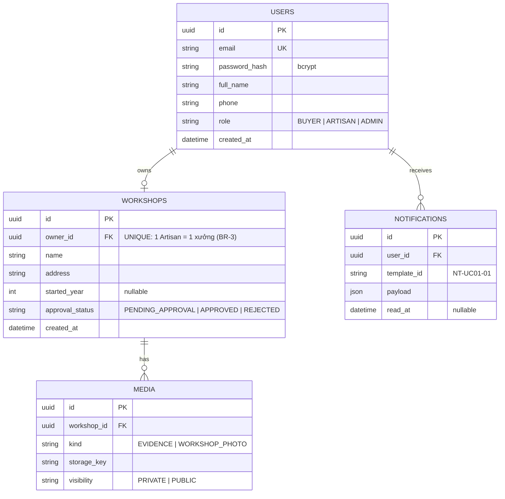
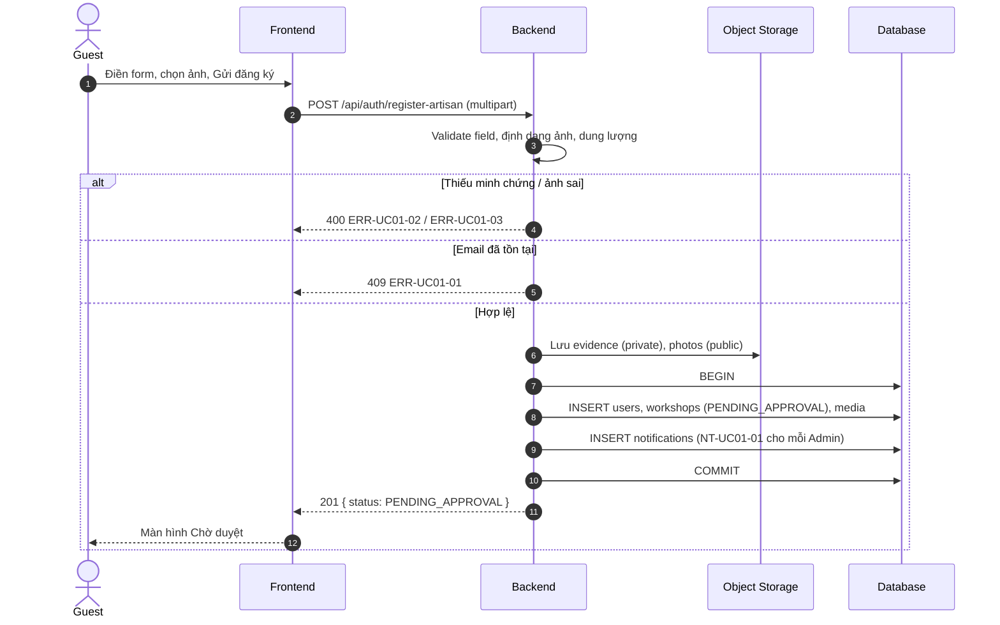

<!-- VÍ DỤ MẪU: chỉ đặc tả UC-01 (Đăng ký tài khoản Artisan). -->

# Tài khoản — Architecture

> **Component:** account
> **Scope:** Hộ làng nghề đăng ký tài khoản Artisan kèm minh chứng trên Frontend; Backend lưu hồ sơ, ảnh và đặt trạng thái chờ duyệt.
> **Related:** [Feature Description](02-feature-description.md) · [Test Cases](03-test-cases.md) · [BRD 01-account](../../brd/01-account/usecase.md)

---

## 0. Summary

Người đại diện hộ điền form trên Frontend và gửi kèm ảnh minh chứng, ảnh xưởng trong **một request multipart**. Backend kiểm tra dữ liệu, lưu ảnh vào object storage, rồi trong một transaction tạo `users` (role `ARTISAN`), `workshops` (`approval_status = PENDING_APPROVAL`), `media` và thông báo cho Admin.

**In scope:**

- API đăng ký Artisan kèm upload ảnh.
- Trang Trạng thái hồ sơ cho Artisan đang chờ duyệt.
- Thông báo in-app `NT-UC01-01`.

**Out of scope:**

- Admin duyệt / từ chối (UC-02, chưa viết).
- Đăng nhập, phiên làm việc.

---

## 1. System Context

| Actor / System | Role | Direction | Channel |
|---|---|---|---|
| **Guest (người đại diện hộ)** | Điền form, tải ảnh, gửi đăng ký | Inbound | HTTPS / Frontend |
| **Frontend** | Form đăng ký, màn hình Chờ duyệt | Client | REST, multipart |
| **Backend API** | Validate, lưu hồ sơ, tạo thông báo | Core | REST |
| **Database** | Lưu `users`, `workshops`, `media`, `notifications` | Outbound | SQL |
| **Object Storage** | Lưu ảnh: minh chứng ở vùng **private**, ảnh xưởng ở vùng public | Outbound | HTTPS |

---

## 2. Module Structure

| Module | Trách nhiệm | Thành phần chính |
|---|---|---|
| `auth` (Backend) | Nhận request đăng ký, băm mật khẩu | `registerArtisan` |
| `media` (Backend) | Kiểm tra định dạng, dung lượng; lưu storage | `saveImages` |
| `notifications` (Backend) | Tạo thông báo theo template | `notify` |
| Frontend | Form đăng ký, màn hình Chờ duyệt | `RegisterArtisanPage`, `PendingPage` |

---

## 3. Data Model

Trạng thái duyệt đặt trên `workshops` chứ không trên `users`, vì chỉ Artisan cần duyệt và mỗi Artisan có đúng một xưởng.

---

## 4. API Surface

| Method | Endpoint | Role | Description | UC |
|---|---|---|---|---|
| `POST` | `/api/auth/register-artisan` | Guest | Multipart: thông tin chủ hộ, xưởng, `evidence[]`, `photos[]`. Tạo tài khoản ở `PENDING_APPROVAL`. | UC-01 |
| `GET` | `/api/me/application` | Artisan | Trả trạng thái hồ sơ cho trang Trạng thái hồ sơ. | UC-01 |

**Định dạng lỗi:** `{ "code": "ERR-UC01-01", "message": "..." }`

| Code | HTTP |
|---|---|
| `ERR-UC01-01` Email đã được sử dụng | 409 |
| `ERR-UC01-02` Thiếu minh chứng | 400 |
| `ERR-UC01-03` Ảnh không hợp lệ | 400 |

---

## 5. Technical Flows

### 5.1 Đăng ký Artisan

Nếu ghi DB lỗi sau khi đã lưu ảnh, Backend xóa các ảnh vừa lưu để không để lại file rác.

---

## 6. Security & Non-Functional

1. **Mật khẩu:** băm bcrypt; không ghi log, không trả về trong response.
2. **Minh chứng:** lưu vùng private, chỉ Admin xem được. Không bao giờ hiển thị công khai.
3. **Upload:** Backend tự kiểm tra định dạng (JPG, PNG, WebP) và dung lượng (≤ 10 MB), không tin kiểm tra ở Frontend.
4. **Artisan chưa duyệt (BR-1):** chỉ gọi được `/api/me/application`; các API khác của Portal trả 403. Xưởng `PENDING_APPROVAL` không xuất hiện ở API công khai.
