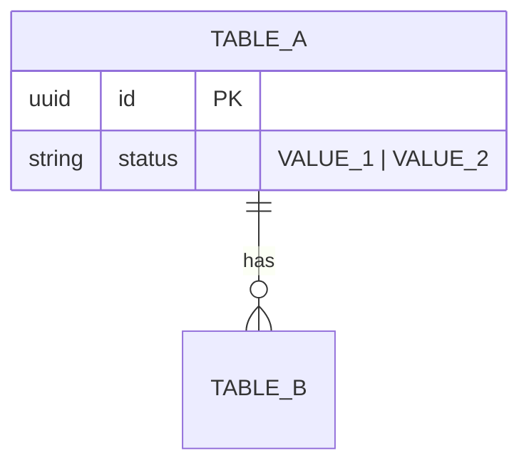
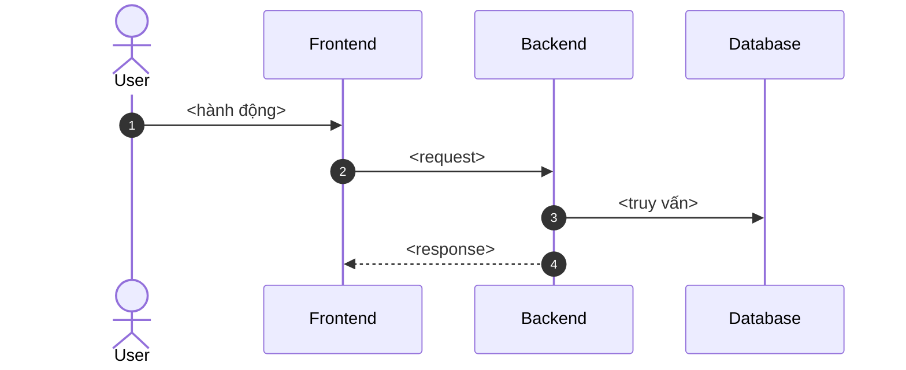

<!--
HƯỚNG DẪN
- SRS trả lời câu hỏi "làm thế nào": bảng dữ liệu, API, luồng giữa các thành phần, bảo mật.
- Mỗi SRS đi kèm một BRD. Mọi mã UC / BR / ERR / NT phải khớp với BRD.
- Diagram viết bằng Mermaid ngay trong file.
- Xem ví dụ: srs/01-account/
-->

# <Tên nhóm chức năng> — Architecture

> **Component:** <tên-component>
> **Scope:** <1–2 câu: phần kỹ thuật nào của nhóm chức năng được đặc tả ở đây.>
> **Related:** [Feature Description](02-feature-description.md) · [Test Cases](03-test-cases.md) · [BRD NN-<slug>](../../brd/NN-<slug>/usecase.md)

---

## 0. Summary

<!-- Một đoạn mô tả luồng kỹ thuật từ đầu đến cuối, rồi liệt kê phạm vi. -->

<Mô tả.>

**In scope:**

- <...>

**Out of scope:**

- <...>

---

## 1. System Context

<!-- Ai / hệ thống nào tham gia, và giao tiếp qua kênh gì. -->

| Actor / System | Role | Direction | Channel |
|---|---|---|---|
| **<Actor>** | <...> | Inbound | HTTPS / Frontend |
| **Backend API** | <...> | Core | REST |
| **Database** | <...> | Outbound | SQL |

---

## 2. Module Structure

<!-- Module nào trong code chịu trách nhiệm gì. Khi có code thì ghi đường dẫn thật. -->

| Module | Trách nhiệm | Thành phần chính |
|---|---|---|
| `<module>` | <...> | <...> |

---

## 3. Data Model

<!-- Chỉ các bảng và cột nhóm chức năng này dùng tới. Ghi rõ PK, FK, UK, giá trị enum. -->

---

## 4. API Surface

| Method | Endpoint | Role | Description | UC |
|---|---|---|---|---|
| `POST` | `/api/<...>` | <Role> | <...> | UC-NN |

**Định dạng lỗi:** `{ "code": "ERR-UCNN-01", "message": "..." }`

| Code | HTTP |
|---|---|
| `ERR-UCNN-01` <Điều kiện> | 400 |

---

## 5. Technical Flows

<!-- Một sequence diagram cho mỗi luồng chính; dùng alt / else cho các nhánh lỗi. -->

### 5.1 <Tên luồng>

---

## 6. Security & Non-Functional

<!-- Phân quyền, dữ liệu nhạy cảm, toàn vẹn dữ liệu, hiệu năng — chỉ những gì liên quan nhóm chức năng này. -->

1. **<Chủ đề>:** <...>
